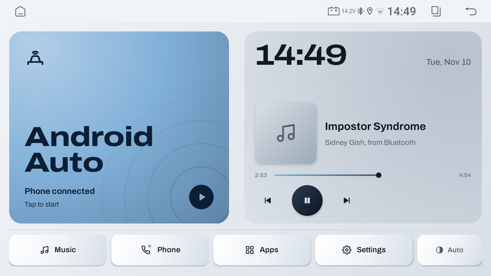
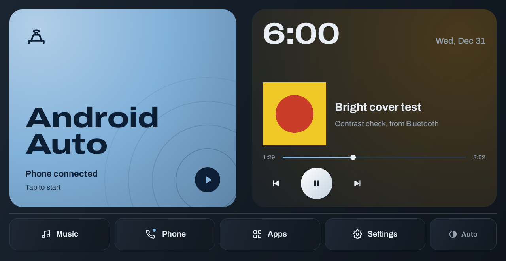

# Car Home

A clean, fast home screen for a cheap Chinese Android car head unit. It puts **wireless Android Auto** and **Bluetooth music** up front, follows the **headlights** for day/night, and replaces a laggy, cluttered stock launcher.

Built for a Youmecity unit in a Nissan Kicks (Topway/Dofun firmware, Allwinner A133, Android 10). Most Topway "T100" units should be close; other platforms need the vendor hooks re-checked (see [HANDOFF_PROMPT.md](HANDOFF_PROMPT.md)).

| On the unit (day) | Night theme (test render) |
|---|---|
|  |  |

## What it does
- **Android Auto tile.** Opens zlink, the unit's wireless Android Auto/CarPlay receiver.
- **Now playing for Bluetooth music.** Shows title, artist, a live progress bar and play/pause/skip that actually control the phone. The vendor BT app ignores normal Android media keys, so Car Home uses the unit's own broadcasts (details below).
- **Bluetooth audio that stays on.** The MCU routes one audio source at a time. Car Home reads the real current source from the vendor system service and switches back to Bluetooth when needed, without showing the BT app.
- **Headlights → dark mode.** Watches the headlight line and switches the whole system to night mode, including Android Auto.
- **Themes.** The "Glacier" theme (light/dark) is built from a small theme registry, so new themes are one data object. Archivo variable font (OFL).
- **Dock.** Music, Phone, Apps drawer, Settings, and a theme-mode toggle (Auto / Light / Dark).

## How the unit is driven (the hard-won part)
All of these were found by dexdumping the vendor apps, then proven from `adb` on the unit before coding.

| Need | Mechanism |
|---|---|
| BT play/pause/next/prev | broadcast `com.unisound.unicar.broadcast.action`, extra `type` = `pp` / `next` / `prev` |
| BT audio on/off | broadcast `net.easyconn.a2dp.acquire` / `net.easyconn.a2dp.release` |
| Now playing | send `com.unisound.intent.action.GET_ID3_INFO` → receive `SEND_ID3_INFO` ~1/s (title, artist, progress, duration) |
| Current audio source | bind `com.tw.service.xt` CommandService, register a callback (tx 1), request with tx 67; pushes `Source_recieve` / `SourceValue` (8 = BT) |
| Night mode | read `/sys/class/twctrl/panel_lights`, send `cn.cardoor.variety.intent.action.DAY_NIGHT_CHANGED` |

Full notes, traps and safety rules: [UNIT_INFO.md](UNIT_INFO.md).

## Build & install
Requires Android Studio's JDK and the Android SDK (minSdk/targetSdk 29).
```bash
cd launcher
./gradlew assembleDebug testDebugUnitTest      # build + 60 Robolectric tests (no emulator needed)
cd .. && ./car_setup.sh <unit_ip>              # install over ADB, grant permissions, screenshot
adb shell cmd package set-home-activity dev.gus.carhome/.HomeActivity   # make it the home screen
```
Revert to the stock launcher on this unit: `adb shell cmd package set-home-activity com.dofun.variety/com.dofun.overseasvariety.Launcher`.

## Repository map
| Path | Purpose |
|---|---|
| [`launcher/`](launcher/README.md) | The Car Home app (Kotlin, framework Views). File-by-file guide + tests |
| [`NEXT_STEPS.md`](NEXT_STEPS.md) | Current status, what to retest, known limits, ideas |
| [`UNIT_INFO.md`](UNIT_INFO.md) | Verified hardware facts, vendor codes, platform quirks, safety rules |
| [`HANDOFF_PROMPT.md`](HANDOFF_PROMPT.md) | Step-by-step prompt for doing this on a different head unit |
| [`launcher/REVIEW.md`](launcher/REVIEW.md) | Code/UI review findings and fixes |
| `connect.sh`, `car_setup.sh` | Reconnect ADB over Wi-Fi; one-shot install |
| `identify.sh` | Read-only hardware report over ADB |
| `debloat.sh`, `debloat_list.txt`, `DEBLOAT_PLAN.md` | Disable stock bloat (`./debloat.sh restore` undoes it) |

Not published: device backups, hardware reports, photos and the vendor APK dumps (`research/`). They are device-specific or third-party code; the docs describe how to regenerate them.

## ⚠️ Safety
- On Topway/Dofun units, **never type plain `7890` in Settings → System → Restore factory settings.** It is the factory-reset password.
- Don't flash firmware or touch factory menus (models, CID, steering wheel, reverse camera, backlight current). Everything here is reversible.

## Status
Working on the car: Android Auto, BT controls and now-playing, headlights → dark mode, default launcher. The Bluetooth-audio restore after leaving Home is installed and awaiting an on-car retest (see [NEXT_STEPS.md](NEXT_STEPS.md)).

Personal project, provided as-is. Use on your own unit at your own risk.
